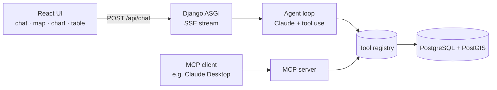

# ⚡ WattWhere

**Ask questions about the energy transition in Baden-Württemberg in plain language, and get answers as streamed text, a map, a chart and a table.**

Municipal energy planners and citizens can see how much solar, wind, biomass, hydro and battery storage is installed
in any town or district, how places compare, and how capacity has grown, straight from the official
Marktstammdatenregister, without writing SQL or opening a GIS.

> "Which 10 municipalities have the most solar capacity per inhabitant?" returns a ranked list, a choropleth of all
> 1,103 municipalities, and a caveat about tiny villages. Every number comes from a tool, never from the model's memory.

## Features

- **Chat with an agent** (Claude with tool use), answers stream in as they are written; each tool call is shown as a step you can expand.
- **Map, chart and table** update with every answer: choropleth rankings, unit points with a radius circle, area highlights, time-series charts, sortable tables.
- **Six tools** over PostGIS: municipality/district lookup, capacity summary, rankings, spatial search, time series, and a heavily guarded read-only SQL fallback.
- **Same tools over MCP**, so Claude Desktop or any MCP client can use them too.
- **Evaluation suite**: 25 questions scored against ground truth computed from the database.
- **Modern UI**: light/dark mode, New chat button, and draggable panels (chat | map | results | chart | table) whose sizes are remembered.

## How it works



One set of tools is exposed twice: to the in-app agent and over MCP. Large payloads (GeoJSON, tables) go straight to the
browser and never into the model's context; the model only sees compact numbers.
Details: [docs/ARCHITECTURE.md](docs/ARCHITECTURE.md).

## Quickstart (sample data, under 5 minutes)

Requires Docker, Node ≥ 20 and [uv](https://docs.astral.sh/uv/).

```bash
make setup          # installs backend + frontend dependencies, creates .env from .env.example
# edit .env and set ANTHROPIC_API_KEY (only the chat needs it; tests run without it)
make db-up          # PostGIS on localhost:5433
make migrate
make seed-sample    # SYNTHETIC data: 5 box-shaped municipalities around Freiburg, ~200 random units
make dev-backend    # terminal 1: http://localhost:8000
make dev-frontend   # terminal 2: http://localhost:5173  (proxies /api to the backend)
```

> ⚠️ The sample data is **synthetic** (boxes and random units). Never read its numbers as facts.

### Real data

```bash
make import-geo     # BKG VG250-EW: 1,103 municipalities with boundaries and population
make import-mastr   # MaStR bulk export: a SEVERAL-GB download (~9 GB on disk, ~30 min); asks first. The import itself takes ~35 s
```

Where to download the boundaries, the exact column mapping, licences and caveats are in [docs/DATA.md](docs/DATA.md).
Importers are idempotent (re-running replaces the data).

## Configuration

Copy `.env.example` to `.env` (done by `make setup`). `.env` is git-ignored.

| Variable | Meaning |
|---|---|
| `ANTHROPIC_API_KEY` | Required for the chat and the eval |
| `ANTHROPIC_MODEL` | Default `claude-sonnet-5-5`; `claude-haiku-5-5` is cheaper for development |
| `DATABASE_URL` / `READONLY_DATABASE_URL` | App connection and the SELECT-only role used by the guarded SQL tool |
| `REGION_LAND_PREFIX`, `REGION_NAME` | Region filter (default `08`, Baden-Württemberg) |
| `OUTPUT_PATH` | Where the MaStR download goes (default `./data/open-mastr`, git-ignored) |
| `DJANGO_SECRET_KEY`, `DJANGO_DEBUG` | Django settings; change the secret for anything beyond local use |

## Make targets

| Target | What it does |
|---|---|
| `make setup` | Install backend and frontend dependencies, create `.env` |
| `make db-up` / `make db-down` | Start / stop the PostGIS container (data lives in a Docker volume) |
| `make migrate` | Apply migrations |
| `make seed-sample` | Load the synthetic sample dataset |
| `make import-geo`, `make import-mastr` | Import real municipalities / units |
| `make dev-backend`, `make dev-frontend` | Run the servers with reload |
| `make test` | Backend and frontend tests; offline, no API key needed |
| `make lint` | Ruff (backend), oxlint and prettier (frontend) |
| `make eval` | Run the evaluation (needs real data and an API key; costs a little) |
| `make mcp-inspect` | Open the MCP Inspector against the MCP server |

## Example questions

- How much solar capacity is installed in Freiburg im Breisgau?
- Which 10 municipalities in Baden-Württemberg have the most solar capacity per inhabitant?
- Show me wind turbines within 25 km of Freiburg.
- How has battery storage capacity in Freiburg grown since 2015?
- Compare solar and wind capacity in the Breisgau-Hochschwarzwald district.
- Wie viele Batteriespeicher gibt es in Emmendingen? (answers in the language of the question)

## Using the tools from Claude Desktop (MCP)

Add this to `claude_desktop_config.json` (replace the path):

```json
{
  "mcpServers": {
    "wattwhere": {
      "command": "uv",
      "args": ["run", "--directory", "/ABSOLUTE/PATH/TO/wattwhere/backend", "python", "-m", "mcp_server.server"]
    }
  }
}
```

The database must be running (`make db-up`). Test with `make mcp-inspect`. The server also exposes the resource `wattwhere://schema`.

## Design decisions

- **The model never sees big payloads.** Tools return `llm_content` (totals, top-N) for the model and `display` (GeoJSON, charts, tables) for the browser only. Cheaper, faster, and fewer numbers to garble.
- **Numbers only from tools.** The system prompt forbids figures from memory and requires stated defaults (net capacity, units in operation) and the coordinates caveat. Tool errors come back as data so the model can correct itself; hallucinated tool names are handled silently.
- **Agent loop as an async generator of typed events** (SSE): concurrent tool calls, an 8-round cap, one retry on overload, cancel-on-disconnect, prompt caching.
- **Guarded SQL fallback in 7 layers:** sqlglot AST checks with table *and function allow-lists*, execution of the regenerated SQL, a row cap, a SELECT-only Postgres role in a read-only transaction with a 5 s timeout, geometry stripped from results.
- **PostGIS without GeoDjango:** geometry columns via migrations and raw parameterized SQL.
- **Frontend:** React + TypeScript (strict), a `useReducer` chat state, a hand-written POST-capable SSE parser (unit-tested across chunk boundaries), validation only at the JSON boundary, CSS-variable theming.

## Evaluation

25 questions (lookup, ranking, spatial, time series, edge cases) are scored for numeric accuracy against SQL-computed
ground truth, tool choice, caveats, out-of-scope handling and language. With `claude-haiku-5-5`:

| Run | Score |
|---|---|
| Baseline | 22/25 |
| Two mistakes in the eval itself fixed (same prompt) | 24/25 |
| After one prompt / tool-description change | 25/25 (twice) |

These are single runs of a non-deterministic model; see [docs/EVAL.md](docs/EVAL.md) for the failures and their causes.

## Testing

`make test` runs ~130 backend tests (tools against a synthetic fixture, the SQL guard's allow/reject cases, the agent loop with a scripted fake client, SSE endpoint, MCP server, eval scoring) and ~35 frontend tests (SSE parser, chat reducer, layout maths, theme, rendered components). None need a network or an API key.

## Troubleshooting

- **"connection refused" on port 5433:** the database container is stopped (e.g. after a Docker restart). Run `make db-up`; the data is kept in a Docker volume.
- **Chat shows "no ANTHROPIC_API_KEY configured":** set it in `.env` and restart `make dev-backend`.
- **Empty or odd answers on sample data:** the sample is synthetic and tiny; use the real-data imports for realistic results.

## Limitations

- **Most small rooftop solar and home batteries have no public coordinates** (privacy). Totals per municipality are complete; map points are not (about 4% of solar units have coordinates). The agent says so.
- Capacity is the registered *net* capacity of units *in operation*; the register can lag reality or contain errors.
- Per-capita figures use the population at 31.12.2025.
- The backend is stateless: follow-up questions use the text of earlier answers, not earlier tool outputs.
- One region (Baden-Württemberg), English UI, no authentication, not deployment-hardened.
- The data snapshot is whatever you downloaded; re-run the importers to refresh.

## Project layout

```
backend/     Django: energy (models, importers, tools) · agent (loop + SSE) · mcp_server · eval
frontend/    Vite + React + TypeScript + Tailwind
db/          init SQL (extensions, read-only role)
docs/        ARCHITECTURE · DATA · EVAL · BUILD_LOG
```

See also [backend/README.md](backend/README.md) and [frontend/README.md](frontend/README.md).

## Data attributions

- Datenquelle: Marktstammdatenregister (Bundesnetzagentur), dl-de/by-2-0
- © BKG (2025), dl-de/by-2-0 (VG250-EW)
- Map data © OpenStreetMap contributors
