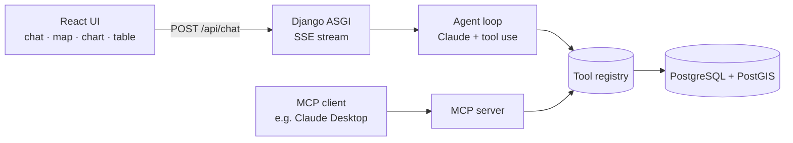

# ⚡ WattWhere

**Ask questions about the energy transition in Baden-Württemberg in plain language, and get answers as streamed text, a map, a chart and a table.**
Municipal energy planners and citizens can explore how much solar, wind, biomass, hydro and battery storage is installed
in any town or district, how it compares, and how it grew, straight from the official Marktstammdatenregister, without
writing SQL or opening a GIS.

> "Which 10 municipalities have the most solar capacity per inhabitant?" → ranked list, a choropleth of all 1,103
> municipalities, and a caveat about tiny villages. All numbers come from tools, never from the model's memory.

<!-- Screenshots: add to docs/screenshots/ and link here (see "Screenshots" below). -->

## How it works



One set of tools (`find_municipality`, `capacity_summary`, `rank_municipalities`, `units_near`, `capacity_timeseries`,
guarded `run_readonly_sql`) is exposed twice: to the in-app agent and over MCP. Details: [docs/ARCHITECTURE.md](docs/ARCHITECTURE.md).

## Quickstart: sample data, under 5 minutes

Needs Docker, Node ≥ 20 and [uv](https://docs.astral.sh/uv/).

```bash
make setup          # installs backend + frontend deps, creates .env
# put your ANTHROPIC_API_KEY into .env (needed only for the chat; tests run without it)
make db-up          # PostGIS on localhost:5433
make migrate
make seed-sample    # SYNTHETIC data: 5 box-shaped municipalities around Freiburg, ~200 random units
make test           # backend + frontend tests, offline
make dev-backend    # terminal 1: http://localhost:8000
make dev-frontend   # terminal 2: http://localhost:5173
```

> ⚠️ The sample data is **synthetic** (boxes and random units). Never read its numbers as facts.

### Real data

```bash
make import-geo     # BKG VG250-EW: 1,103 municipalities with boundaries + population (see docs/DATA.md for the download)
make import-mastr   # MaStR bulk export: SEVERAL GB download (~9 GB on disk, ~30 min), asks first; then ~35 s import
```

`docs/DATA.md` documents sources, licences, the exact column mapping and caveats.

## Example questions

- How much solar capacity is installed in Freiburg im Breisgau?
- Which 10 municipalities in Baden-Württemberg have the most solar capacity per inhabitant?
- Show me wind turbines within 25 km of Freiburg.
- How has battery storage capacity in Freiburg grown since 2015?
- Compare solar and wind capacity in the Breisgau-Hochschwarzwald district.
- Wie viele Batteriespeicher gibt es in Emmendingen? (answers in the language of the question)

## Design decisions

- **The model never sees big payloads.** Tools return `llm_content` (totals, top-N) for the model and `display`
  (GeoJSON, charts, tables) for the browser only. Cheaper, faster, and fewer numbers to garble.
- **Numbers only from tools.** The system prompt forbids figures from memory, requires stated defaults (net capacity, units in
  operation) and the coordinates caveat. Errors come back as data so the model can self-correct.
- **Agent loop as an async generator of typed events** (SSE: `text_delta`, `tool_call`, `tool_result`, `display`, …);
  concurrent tool calls, 8-round cap, one retry on overload, cancel-on-disconnect, prompt caching.
- **Guarded SQL fallback in 7 layers**: sqlglot AST checks with table *and function allow-lists*, execution of the
  regenerated SQL, row cap, a SELECT-only Postgres role in a read-only transaction with a 5 s timeout, geometry stripped.
- **One tool layer, two front doors (web agent + MCP).**
- **PostGIS without GeoDjango**: geometry columns via migrations and raw parameterized SQL.
- **Frontend**: React + TypeScript (strict) with a `useReducer` chat state, a hand-written POST-capable SSE parser
  (unit-tested across chunk boundaries), validation only at the JSON boundary.

## MCP: use the tools from Claude Desktop

Add to `claude_desktop_config.json` (replace the path):

```json
{
  "mcpServers": {
    "wattwhere": {
      "command": "uv",
      "args": ["run", "--directory", "/ABSOLUTE/PATH/TO/wattwhere/backend", "python", "-m", "mcp_server.server"]
    }
  }
}
```

The database must be running (`make db-up`). Test with the Inspector: `make mcp-inspect`. Resource: `wattwhere://schema`.

## Evaluation

25 questions (lookup, ranking, spatial, time series, edge cases) scored for numeric accuracy against SQL-computed ground
truth, tool choice, caveats, out-of-scope handling and language. Results with `claude-haiku-5-5`:

| Run | Score |
|---|---|
| Baseline | 22/25 |
| After fixing two mistakes in the eval itself (same prompt) | 24/25 |
| After one prompt/tool-description change | 25/25 (twice) |

Single runs of a non-deterministic model; see [docs/EVAL.md](docs/EVAL.md) for failures, causes and caveats.
Run it yourself with real data and a key: `make eval`.

## Limitations

- **Most small rooftop solar and home batteries have no public coordinates** (privacy). Totals per municipality are
  complete; map points are not (4% of solar units have coordinates). The agent says so.
- Capacity is the registered *net* capacity of units *in operation*; the register can lag reality or contain errors.
- Per-capita figures use population at 31.12.2025.
- Backend is stateless: follow-up questions use earlier answers' text, not earlier tool outputs.
- Single region (Baden-Württemberg), English UI, no auth, not deployed. Bundle ~980 kB (no code-splitting).
- Data snapshot is whatever you downloaded; re-run the importers to refresh.

## Screenshots

Take them with the app running on real data and save to `docs/screenshots/`.

## Data attributions

- Datenquelle: Marktstammdatenregister (Bundesnetzagentur), dl-de/by-2-0
- © BKG (2025), dl-de/by-2-0 (VG250-EW)
- Map data © OpenStreetMap contributors

## Project layout

`backend/` Django (apps `energy`: models, importers, tools; `agent`: loop + SSE; `mcp_server`; `eval`) · `frontend/` Vite + React ·
`docs/` ARCHITECTURE, DATA, EVAL, BUILD_LOG · `db/init.sql` extensions + read-only role.
