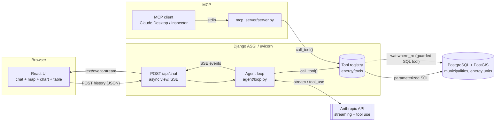
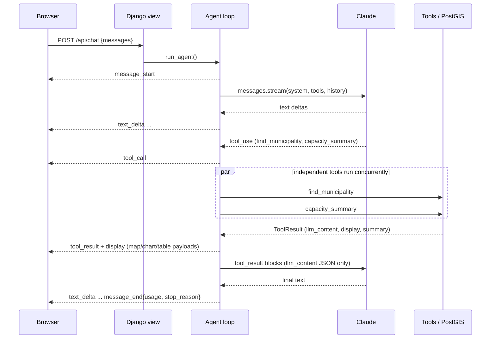

# Architecture

## Request flow



**One tool layer, two front doors.** Every capability lives once in `energy/tools/` and is registered in `REGISTRY`
(function + JSON schema + description). The web agent and the MCP server both read from it.

## One chat turn



Heartbeat comments (`: ping`) are sent every 15 s while a slow tool runs. If the browser disconnects, the view's
stream wrapper cancels the agent task, which closes the LLM stream and prevents further tool rounds.

## Event protocol (`backend/agent/events.py` ↔ `frontend/src/api/types.ts`)

Each SSE message is `event: <type>\ndata: <json>\n\n`.

| type | data | when |
|---|---|---|
| `message_start` | `{id}` | once, first |
| `text_delta` | `{text}` | each streamed chunk |
| `tool_call` | `{id, name, input}` | model asked for a tool (before it runs) |
| `tool_result` | `{id, name, summary, ok, duration_ms}` | tool finished |
| `display` | `{tool_call_id, payload}` | one per UI payload the tool produced |
| `error` | `{message, retryable}` | failure (generic text, never stack traces or keys) |
| `message_end` | `{usage, stop_reason}` | once, last (also after `error`) |

`DisplayPayload.kind` ∈ `map_choropleth | map_points | map_highlight | chart_line | table`.

## Tool-layer design

```python
@dataclass
class ToolResult:
    llm_content: dict   # compact: totals, top-N. The ONLY thing the model sees.
    display: list[dict] # GeoJSON, charts, tables. Goes to the browser only.
    summary: str        # one line for the tool-call chip
```

- **Big payloads never enter the LLM context.** A region-wide choropleth is ~2 MB; the model gets ten rows.
  Cheaper, faster, and the model can't mangle numbers it never had to copy.
- **Errors are data**, not exceptions: `{"error": ..., "allowed": [...]}` lets the model correct itself.
- **Arguments are validated** against the tool's JSON schema in one place (`call_tool`).
- **SQL is always parameterized.** Fixed fragments (metric expressions) come from constant maps.
- **Defaults are explicit** and echoed in results: net capacity, units in operation; kW in data, MW in summaries.
- **The coordinate gap is part of the data contract:** `units_near` reports how many matching units in nearby
  municipalities have no public coordinates.

### Guarded SQL (`run_readonly_sql`)

1. sqlglot (Postgres dialect): exactly one `SELECT`.
2. AST walk: no DML/DDL/`INTO`/locks/commands anywhere, including in CTEs.
3. Table allow-list (`energy_municipality`, `energy_energyunit`); function allow-list (not a deny-list).
4. The SQL that runs is **regenerated from the AST**, so comments can't smuggle anything.
5. Wrapped in `SELECT * FROM (...) q LIMIT 500`.
6. Executed as role `wattwhere_ro` (SELECT on two tables only, default read-only) in a `READ ONLY` transaction with
   `statement_timeout = 5s`.
7. Geometry columns are stripped from results by type.

## Data model

- `energy_municipality(ags PK, name, name_normalized, district_ags, district_name, population, area_km2, centroid_*, geom, geom_simplified)`
  - `geom`, `geom_simplified` are PostGIS columns added by a `RunSQL` migration (no GeoDjango); GIST + trigram indexes.
- `energy_energyunit(mastr_id PK, technology, status, net/gross_capacity_kw, storage_capacity_kwh, commissioning_date, municipality_id, lat, lon, geom, ...)`
  - composite index `(municipality_id, technology, status)`; `geom` is NULL for units without public coordinates.
- `energy_datameta`: snapshot dates shown in the UI and injected into the system prompt.

See `docs/DATA.md` for sources, column mapping and caveats.

## Statelessness

The backend keeps no sessions. The client sends the visible text history (last 20 messages). Prior tool calls are not
replayed to the model; follow-up questions work from the text of earlier answers. A deliberate simplification.
